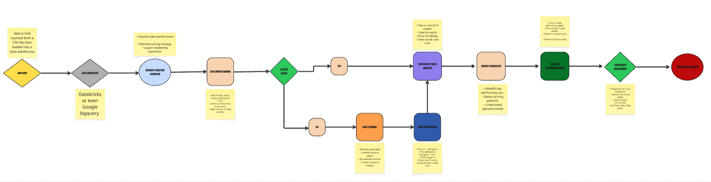

<div align="center">

# 🚗 Bright Motors — Car Sales Analysis

**Helping a new Head of Sales decide which cars to stock, how to price them, and where to expand.**


</div>

---

## 🎯 The business question

Bright Motors appointed a new Head of Sales who needs answers fast:

- Which **makes and models** drive the most revenue?
- How do **price, condition and mileage** relate to each other?
- Which **regions (states)** perform best, and where should we expand?
- How do **selling prices compare to market value (MMR)**?

## ⚡ Key insights

| # | Insight | So what? |
|---|---|---|
| 1 | A handful of brands (e.g. BMW, Kia, Volvo) dominate sales volume | Concentrate inventory on proven sellers |
| 2 | Lower-mileage vehicles consistently sell at higher prices | Prioritise low-mileage stock to lift margin |
| 3 | Market value (MMR) closely drives final selling price | Use MMR trends to set pricing |
| 4 | A few states generate a disproportionate share of sales | Target expansion at top-performing regions |
| 5 | Newer vehicles achieve higher selling prices | Balance stock age against acquisition cost |

## 🧭 How the analysis flows

```text
Raw CSV ──► SQL cleaning ──► Calculated fields ──► SQL analysis ──► Power BI dashboard ──► Presentation
             (dates, dupes,    (price vs MMR,        (make, model,
              missing values)   margin %, y/m/d)      state, trends)
```

**Calculated fields**

| Field | Formula |
|---|---|
| Price difference | `selling_price − mmr` |
| Profit margin % | `(selling_price − mmr) / selling_price × 100` |
| Year / Month / Day | Extracted from `sale_date` |

## 📁 What's in this repo

```text
Motors-CarSales-Analysis/
├── 01-brief-and-raw-data/
│   ├── case-study-brief.pdf                 # The original business brief
│   └── car_sales_data.csv.gz                # Raw transactional data (compressed)
├── 02-project-planning/
│   ├── miro-plan.png                        # Data architecture / analysis plan
│   ├── miro-board-link.txt                  # Link to the live Miro board
│   └── gantt-chart.xlsx                     # Project timeline
├── 03-sql-analysis/
│   ├── 01_cleaning_final_query.sql          # Cleaning + calculated fields
│   ├── 02_analysis_queries.sql              # Business questions answered in SQL
│   └── query-output.xlsb                    # Exported query results
├── 04-dashboard-and-presentation/
│   ├── car-sales-dashboard.pbix             # Power BI dashboard
│   └── vehicle-sales-performance-presentation.pdf
└── README.md
```

> 👉 **Short on time?** Open the [presentation PDF](./04-dashboard-and-presentation/vehicle-sales-performance-presentation.pdf) for the full story in a few slides.

## 🗺️ Analysis plan



## 🗂️ Dataset

Year · Make · Model · Body type · Transmission · State · Condition · Odometer · MMR (market value) · Selling price · Sale date

## 🚀 Recommendations

1. Focus inventory on high-performing brands and models
2. Prioritise low-mileage vehicles to maximise selling price
3. Expand operations in top-performing states
4. Base pricing strategy on MMR trends
5. Track condition and mileage as levers for profitability

## 🛠️ Tools

SQL · Microsoft Excel · Power BI · Miro · PowerPoint / Canva · GitHub

---

<div align="center">

Built by **Siphamandla Moyo** as part of the BrightLearn Data Analytics programme ·
[GitHub](https://github.com/Rocky101798) · [LinkedIn](https://www.linkedin.com/in/godfrey-siphamandla-moyo-761aba152)

</div>
